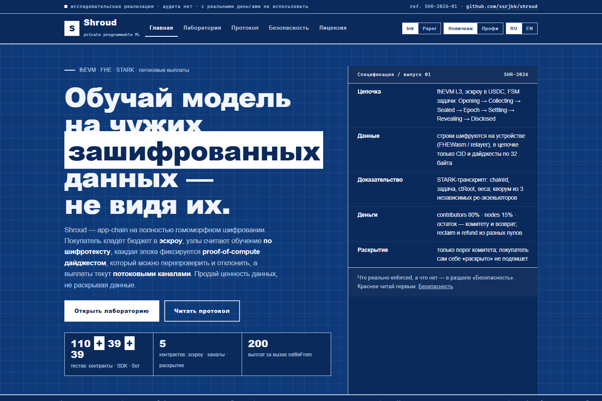
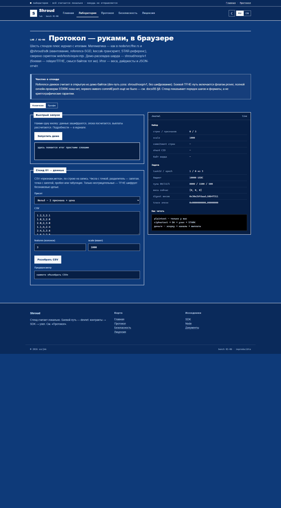
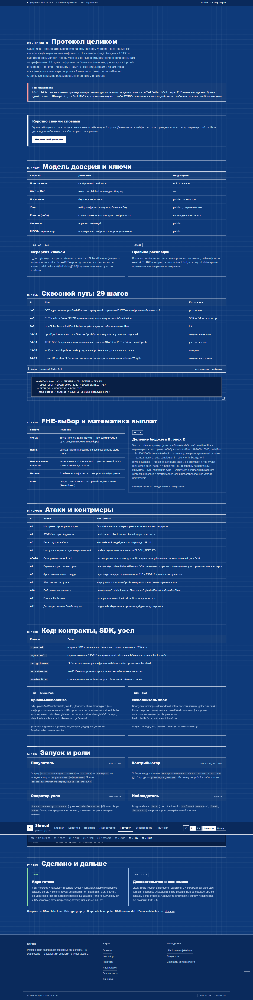
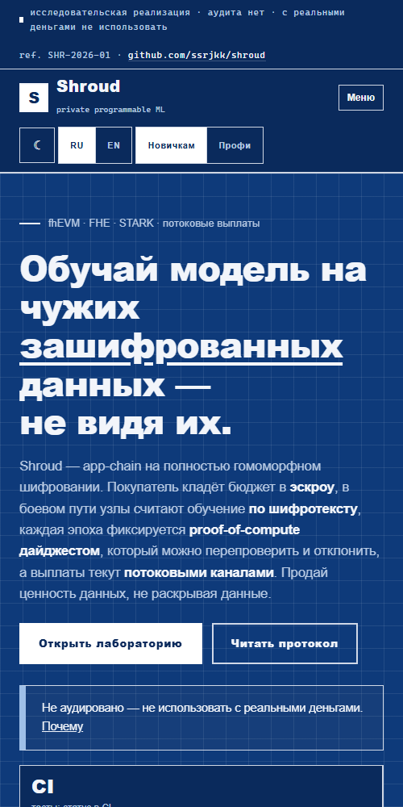

# Shroud — Private, programmable ML with verifiable compute and streaming payouts

> **Research prototype. Not audited. Do not use with real funds or real private data.**
>
> Current compute verification is **fraud-proof / re-execution commitment**, not full
> on-chain STARK verification. Privacy depends on committee assumptions, key
> configuration, and the selected backend.
> Read [`docs/05-honest-limitations.md`](docs/05-honest-limitations.md) and
> [`TRUST_ASSUMPTIONS.md`](TRUST_ASSUMPTIONS.md) before using anything.

[](https://github.com/ssrjkk/shroud/actions/workflows/contracts.yml)
[](https://github.com/ssrjkk/shroud/actions/workflows/sdk.yml)
[](https://github.com/ssrjkk/shroud/actions/workflows/rust.yml)
[](https://github.com/ssrjkk/shroud/actions/workflows/site.yml)
[](https://github.com/ssrjkk/shroud/actions/workflows/bot.yml)
[](LICENSE)

🌐 **Live site: [ssrjkk.github.io/shroud](https://ssrjkk.github.io/shroud/)** — the project,
the protocol, the honest security posture, and a lab that runs the pipeline in your browser.

| [Home](https://ssrjkk.github.io/shroud/) · [Pipeline](https://ssrjkk.github.io/shroud/pipeline.html) · [Practice](https://ssrjkk.github.io/shroud/use.html) · [Lab](https://ssrjkk.github.io/shroud/playground.html) · [Protocol](https://ssrjkk.github.io/shroud/protocol.html) · [Security](https://ssrjkk.github.io/shroud/security.html) · [License](https://ssrjkk.github.io/shroud/license.html) |
|---|

|  |  |
|---|---|
|  |  |

The site is fully static (`web/`, no build step): bilingual RU/EN, ink/paper themes,
newcomer/pro audience modes. The home page is a hub — pipeline, practice, lab,
protocol and security status each have their own address instead of one long scroll.
The lab computes with the same math as the node
and the SDK — quantization, reference SGD, trace digest, proof reference, settlement —
entirely client-side, byte-for-byte against `packages/sdk` and `node/`.

**Train a model over other people's encrypted data — without ever seeing it. Sell the model /
your data's value without revealing either.**

Shroud is an fhEVM (Fully Homomorphic Encryption) app chain. Buyers escrow a budget, nodes
execute training over ciphertext, each epoch is pinned by a proof-of-compute digest that a
quorum of re-executors can dispute, and contributors, nodes and the committee are paid
through streaming payment channels.

```
plaintext ──► FHEWasm ──► ciphertext ──► DA ──► node (FHE execute) ──► STARK proof ref*
                                                                        │   (* fraud-proof commitment today,
buyer ──► CipherTask (escrow + FSM + payment channels) ◄────────────────┘    mock-verified; see Status below)
```

> **Status: research-grade implementation, not audited, do not use with real value.**
> What is actually enforced — and what is not — is listed under
> [Security status](#security-status) and in full in
> [`docs/05-honest-limitations.md`](docs/05-honest-limitations.md). Read that file before
> trusting any claim below.

## Quickstart

**No Docker: contracts and the SDK against a standalone node.** Node 22 and nothing else.
Two terminals:

```sh
# terminal 1 — a chain with the fhEVM mock coprocessor installed
cd packages/contracts && npm ci && npx hardhat node --hostname 127.0.0.1 --port 8545

# terminal 2 — deploy, then run the three smoke checks
cd packages/contracts && npm run deploy:devnet && npm run devnet:e2e && npm run devnet:admin
cd ../sdk && npm ci && npm run build && npm run devnet:sdk
```

The checks end in `DEVNET E2E OK` (create → seal → register), `DEVNET ADMIN OK` (propose a
treasury change, watch it refused before its window, then executed by a non-owner after it)
and `DEVNET SDK E2E OK` (a real `uploadAndMonetize` with on-chain verification). That proves
the contracts, the address book and the SDK agree with each other — not that FHE execution
works: the node and the DA are separate services, and this chain runs the plugin's mock
coprocessor.

**Full devnet: chain + DA + compute nodes (Docker).**

```sh
cd infra && docker compose up -d --build devnet shardstore   # fhEVM chain + DA
cd ../packages/contracts && npm run deploy:devnet             # deploy contracts
npx hardhat run scripts/devnet-e2e-check.ts --network localhost  # create → seal → register smoke
```

`--network localhost` is load-bearing in both paths: the fhevm plugin instruments a
standalone node only under that name (port 8545, chainId 31337). Anything else resolves to
provider type `Unknown`, the mock coprocessor is never installed, and `CipherTask`'s
constructor reverts with no reason.

## Who is this for, and how to use it

- **Buyer — fund a private training task.** Escrow a budget and describe the model:
  `packages/contracts/scripts/devnet-e2e-check.ts` shows the calls
  (`createTask` → contributions land → `sealTask` → `openEpoch` per epoch); the SDK wraps
  them in `ShroudSdk`. Settlement pays contributors, the winning node and the committee
  out of your escrow, and refunds the rest.
- **Contributor — sell your data's value, not the data.** Encrypt rows client-side and
  commit the shard: `sdk.uploadAndMonetize(data, taskId, { features, allowUnencrypted })`
  (production: a real `Encryptor`, e.g. `@shroud/sdk/relayer`). Plaintext never leaves
  your machine; the chain only ever sees CIDs and digests. End-to-end example:
  `packages/sdk/scripts/devnet-check.mjs`.
- **Node operator — run compute and earn epochs.** `docker compose up -d node-a` (see
  [`infra/README.md`](infra/README.md) §3 for every knob: backends, DA, key pin, windows),
  or build `node/` and point it at a task. The node registers, executes, commits, disputes
  from its own commits, and redeems its reward channels.
- **Ops — watch a deployment.** Run the Telegram bot (`bot/`, needs `bot/.env` with a token
  and an allowlist): `/menu` hub, `/pool`, `/task <id>`, mismatch/dispute/rotation/treasury
  alerts with per-chat filters. Setup and limits: [`bot/README.md`](bot/README.md).

## Repository

| path | what |
|------|------|
| `packages/contracts/` | fhEVM Solidity: `CipherTask`, `PaymentVault`, `DecryptionGate`, `NetworkParams`, `ProofVerifier` + Hardhat suite (lifecycle, stateful fuzz, gas snapshot, admin controls, byte-layout vectors — [counts live in CI](https://github.com/ssrjkk/shroud/actions/workflows/contracts.yml)) |
| `packages/sdk/` | `@shroud/sdk` — `uploadAndMonetize(data, taskId)`, `publishWeights`, EIP-712 binding, hardened DA client, on-chain key-pin check, weight files ([counts live in CI](https://github.com/ssrjkk/shroud/actions/workflows/sdk.yml)) |
| `node/` | Rust compute node: chain follower + epoch executor (deterministic reference engine, `tfhe-rs` behind `prover`), gRPC mesh, content-addressed DA (`da` feature for remote) — see [Node](#node) |
| `bot/` | Telegram ops bot: task pool, disputes, **network key rotation alerts** ([counts live in CI](https://github.com/ssrjkk/shroud/actions/workflows/bot.yml), incl. stub-RPC read coverage) |
| `web/` | Project site (static, no build), one page per topic: home hub, pipeline, practice, in-browser lab, protocol, security status, license — RU/EN, ink/paper themes, newcomer/pro modes |
| `infra/` | docker-compose devnet: fhEVM node, ShardStore (DA, size-capped + range-pull), 3 nodes — operator runbook in [`infra/README.md`](infra/README.md) |
| `docs/` | architecture, cryptography, proof-of-compute, threat model, honest limitations |

## Build & test

```sh
# contracts
cd packages/contracts
npm ci && npx hardhat compile && npx hardhat test && npx tsc --noEmit   # counts in CI

# sdk
cd packages/sdk
npm ci && npm test                                                       # counts in CI

# ops bot (no token and no chain needed for the tests)
cd bot
npm ci && npm test                                                       # counts in CI
npm start                                                                # needs bot/.env

# node — needs protoc and a C toolchain; see the note below
cd node
cargo check --all-features && cargo check --no-default-features
cargo test --all-features && cargo test --no-default-features

# site — any static server
cd web && python -m http.server 4173
```

## Node

`node/` follows the chain (reorg-safe watcher → derived fold), executes open epochs
(deterministic fixed-point engine over sealed shards, artefacts published to the
content-addressed store), files disputes from its own commits, and collects its payment
duties (finalize/settle/redeem/reclaim/claim/bond). What it is today:

- **Executes for real** (`reference-cpu` engine, golden-tested; `tfhe-rs` backend behind
  `--features prover`), with the genuine constraints documented in the module docs.
- **Commits a 32-byte proof *reference*** that verifies on mock-verifier chains; a real
  proving system is Phase 3.
- **Verified by CI on Linux, never locally**: on machines where freshly built binaries
  cannot load (locked-down Windows/Smart App Control), `cargo check`/`cargo test` cannot
  run at all — see [`docs/05-honest-limitations.md`](docs/05-honest-limitations.md) §8.
  `cargo fmt` is green.

Operator configuration (backends, DA, key pin, timeouts) is documented in
[`infra/README.md`](infra/README.md) §3.

## Core properties

- **FHE end-to-end**: input rows are encrypted client-side and never decrypted; the final
  weights are committee-revealed after settlement.
- **Proof of compute**: each epoch pins chain, task, dataset root and prior weights in a
  transcript-bound digest. Any registered node can re-execute and report a different digest;
  3 distinct reporters reject the epoch and pay nobody. The quorum is priced by a
  registration bond, **not** Sybil-resistant — see below.
- **Streaming payments**: `PaymentVault` settles in EIP-712 slices as epochs complete, with
  reclaim and buyer-refund paths that cannot touch contributor or committee shares.
- **Settlement scales**: paying a capped contributor set in one call was measured at ~584M
  gas against a 30M block limit, so `settleFrom(taskId, cursor)` pays `SETTLE_PAGE_SIZE`
  (200) contributors per call instead; the final page pays the committee and refunds the buyer.
- **Budgets are explicit**: `createTask(budget, params)` escrows exactly the named amount.
- **Disclosure is attested**: `Disclosed` requires `threshold` real committee partial
  decryptions — the buyer cannot self-declare it.

## Security status

**This code moves funds and has not been externally audited. Do not deploy it with real value.**

| claim | status |
|---|---|
| Escrow accounting is internally consistent | **Enforced.** `totalLocked == subBalances + channelLocks` asserted on every movement (O(1)), plus a deterministic fuzz asserting it after every lifecycle step. |
| Reentrancy on the money path | **Enforced and tested** with a hostile token calling back mid-`transferFrom`. |
| Buyers cannot take contributor/committee funds | **Enforced.** Settle and reclaim draw from disjoint pools. |
| `abort` strands nothing | **Enforced.** Only verified work-in-progress is withheld, as a redeemable channel. |
| Disputes target the real winner | **Enforced.** A losing committer cannot redirect a dispute onto an honest epoch. |
| Disputing is rational | **Enforced.** `reexecutionBps` of the lock goes to reporters; the winner's bond slashes into the buyer refund on quorum reject. |
| `Disclosed` means decrypted | **Enforced.** `withdraw` requires the threshold gate. |
| Key substitution is detected before upload | **Enforced, fail-closed for real encryptors.** A confidential encryptor with a declared key refuses to run without `networkParams` (unless `allowUnpinnedKey`); the node-side check is on by default at startup — it refuses to boot without pins or on a mismatch. |
| Cleartext upload by omission | **Enforced.** Non-encrypting encryptors are refused without `allowUnencrypted`. |
| Wrong-chain signing | **Enforced.** A configured `chainId` mismatch is a hard error. |
| Hostile DA | **Enforced.** CIDs validated pre-request, responses size-capped and timed out, payloads re-hashed locally against the on-chain pin. |
| Admin surface | **Enforced.** The treasury moves through a 7-day rotation that anyone may execute once the window has passed; the shape-proof requirement is a ratchet — it can be tightened, never loosened; the pause stays an immediate owner brake. Verifier and manager rotations behave the same way, and a live rotation cannot be overwritten without a cancel. |
| Fee-on-transfer escrow tokens | **Enforced (fail-closed).** Vault ledgers the balance diff actually received; shortfalls revert instead of mis-accounting. |
| Dispute front-running | **Enforced.** Commit-reveal reporting (`commitDispute` → `reportDisputeWithSalt`); the node files disputes this way. |
| Epoch-authorship by the owner | **Enforced.** Only buyer/update-manager may `openEpoch`; the owner keeps `emergencyUnwind`. |
| Settlement against immature channels | **Enforced.** The final page reverts `ChannelsImmature` until the reward window passes; earlier pages proceed. |
| Sybil-resistant dispute quorum | **NOT enforced — priced, not prevented.** Flat count of 3; locked capital returns after terminality. See `05` §2a. |
| Slashable contribution bond | **Opt-in, not a fraud proof.** `setContributionBondRequirement` + slash-to-treasury exists; no requirement by default and no on-chain proof of poison. |
| Full on-chain STARK verification | **NOT implemented.** Segmented path is reachable (`commitEpochSegmented`) but no prover exists; sampled on chain, completed off-chain. See `05` §3. |
| Committee cannot decrypt rows | **NOT mitigated, by design** (residual F-10). |
| Key-substitution detection by default | **Enforced at boot, not mid-epoch** (fail-closed for confidential encryptors that declare a key; the node checks the on-chain pin at startup by default and refuses to boot without it; forensic detection after the fact). |

## Roadmap

### Done

- **Protocol core:** task FSM + escrow + streaming channels + threshold reveal + rotation
  timelocks; dispute quorum with winner-bond slash; commit-reveal dispute reporting with
  reporter-bound salt; BLS-key proof-of-possession on registration; opt-in contribution
  bonds (slash-to-treasury); segmented-proof commit path; settlement gated on reward
  maturity; fee-on-transfer fail-closed accounting; admin controls under test — the
  treasury moves through a 7-day rotation and the shape-proof requirement is a ratchet
  (it can be tightened, never loosened).
- **Compute:** deterministic execution engine wired into the worker (commit, re-execute,
  commit-reveal disputes from own commits); `tfhe-rs` backend + remote DA behind cargo features;
  inbound mesh throttling per peer IP + stream cap; `strict_weights` on by default; two-node
  devnet agreement check in CI.
- **Clients & ops:** SDK upload/weights/key-pin (fail-closed)/DA hardening + DecryptionGate
  client, Telegram ops bot with read coverage + per-chat abuse quotas + alert dedupe and
  treasury-rotation alerts, content-addressed DA service with perimeter guard (rate limits,
  penalty box, shadowban, idempotency, graceful shutdown), devnet compose, gas snapshot +
  lifecycle fuzz in the suite.

### Next

- [ ] **Proving (Phase 3):** portable compute core extracted (`node/crates/shroud-core`:
  fixed-point SGD, weight/shard formats, ctRoot/transcript/trace layouts; dependency-free
  except `sha3`, wasm32-checked in CI) so a zkVM guest can import it; guest circuit over
  the 8-field transcript, recursive aggregation and CPU/GPU benchmarks still pending.
- [ ] **Cryptoeconomics (Phase 4):** sortition-gated dispute committee is live
  (`COMMITTEE_SIZE` lottery over the registry, first-report fixes the seed; uniform
  weights while bonds are flat) plus Foundry math invariants; reporter-side slashing
  deliberately absent (revert atomicity + typo-indistinguishability, see `DisputeLib`);
  still pending: variable-stake weights, fhEVM Gateway threshold re-encryption.
- [x] **Green devnet-live execution leg:** the two-node agreement script runs green in CI
  (`live node registers + bonds on devnet` in `.github/workflows/rust.yml`).

## Docs

- [`docs/01-architecture.md`](docs/01-architecture.md) — system design and lifecycle
- [`docs/02-cryptography.md`](docs/02-cryptography.md) — TFHE, quantization, DKG, threshold reveal
- [`docs/03-proof-of-compute.md`](docs/03-proof-of-compute.md) — STARK + dispute protocol
- [`docs/04-threat-model.md`](docs/04-threat-model.md) — security analysis
- [`docs/05-honest-limitations.md`](docs/05-honest-limitations.md) — honest MVP scope
- [`infra/README.md`](infra/README.md) — devnet + node operator runbook
- [`bot/README.md`](bot/README.md) — ops bot setup and limits

## Contributing & security

- [CONTRIBUTING.md](CONTRIBUTING.md) — how to build, test and contribute.
- [SECURITY.md](SECURITY.md) — how to report a vulnerability (this protocol moves funds).

## License

MIT — see [LICENSE](LICENSE).
